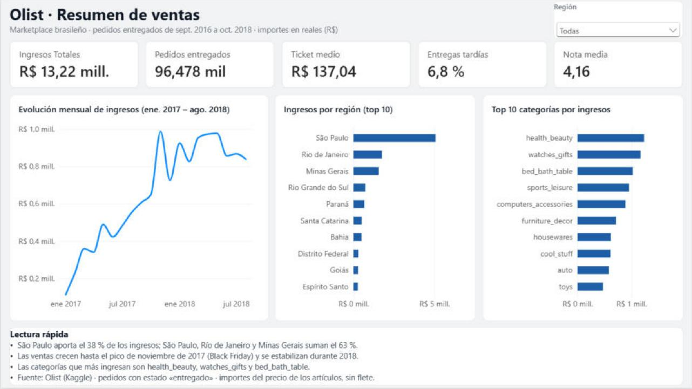
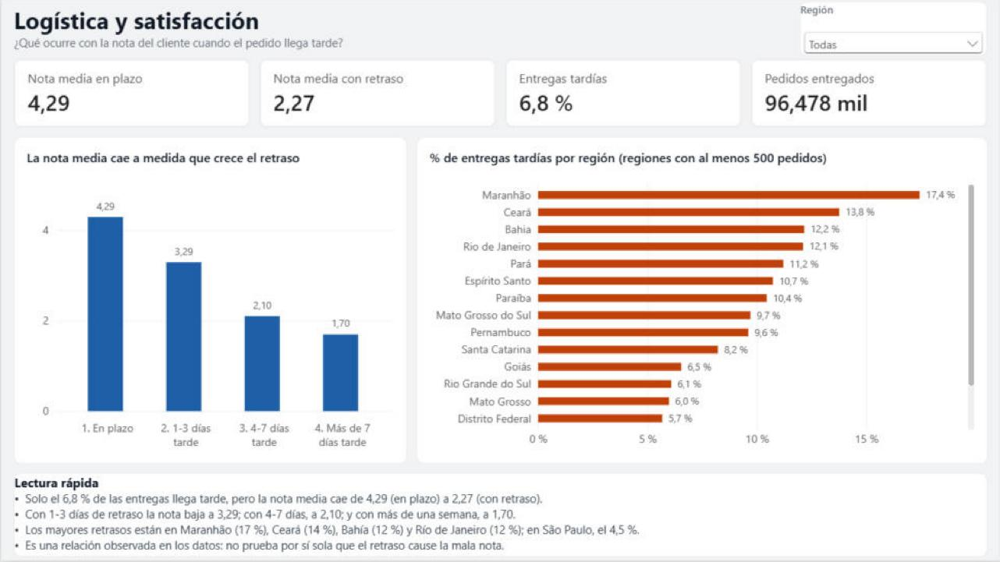
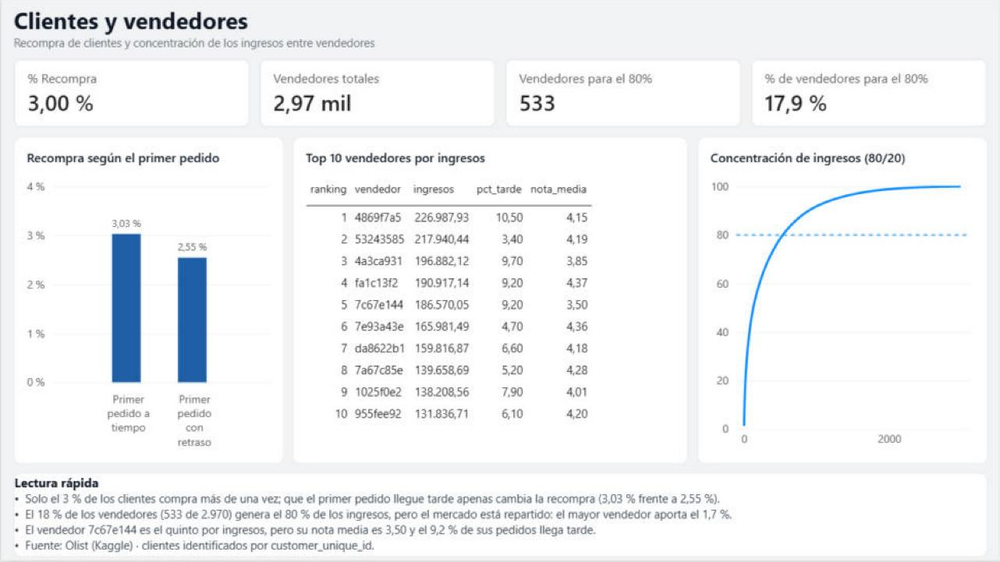

# Logística y satisfacción en un e-commerce: análisis de Olist

**Python · PostgreSQL · Power BI**

Análisis de ~100.000 pedidos de un marketplace brasileño, de los datos en bruto a un dashboard con conclusiones de negocio. La pregunta central del proyecto: **¿qué ocurre con la satisfacción del cliente cuando un pedido llega tarde?**



## Resumen del resultado

- Solo el **6,8 %** de los pedidos entregados llega después de la fecha prometida, pero la nota media de la reseña cae de **4,29** (en plazo) a **2,27** (con retraso). Con más de 7 días de retraso, la nota media es **1,70**.
- El retraso se concentra en el norte y nordeste (Maranhão 17,4 %, Ceará 13,8 %, Bahía 12,2 %) y en **Río de Janeiro (12,1 %)**, frente al 4,5 % de São Paulo.
- **São Paulo concentra el 38 % de los ingresos**; con Río de Janeiro y Minas Gerais suman el 63 %.
- Solo el **3 %** de los clientes vuelve a comprar, y que el primer pedido llegue tarde apenas lo cambia (3,03 % frente a 2,55 %): la baja retención no se explica solo por la logística.
- Se cumple casi al pie de la letra la regla 80/20: el **18 %** de los vendedores (533 de 2.970) genera el 80 % de los ingresos, aunque el mercado está muy repartido (el mayor vendedor aporta solo el 1,7 %).

## Datos

[Brazilian E-Commerce Public Dataset by Olist](https://www.kaggle.com/datasets/olistbr/brazilian-ecommerce) (Kaggle): 9 tablas relacionadas (pedidos, artículos, clientes, vendedores, productos, pagos, reseñas, geolocalización y traducción de categorías). Cubre septiembre de 2016 a octubre de 2018; **el análisis temporal usa enero de 2017 a agosto de 2018**, porque 2016 y los dos últimos meses de 2018 tienen muy pocos pedidos.

## Flujo de trabajo

| Fase | Qué se hizo | Dónde |
|---|---|---|
| 1. Exploración | Perfil de las 9 tablas: claves, nulos, duplicados, coherencia de fechas, trampas al unir tablas | [`notebooks/01_exploracion.ipynb`](notebooks/01_exploracion.ipynb) |
| 2. Limpieza (Python/pandas) | Arreglos tabla a tabla, documentados (ver abajo). Los CSV originales no se modifican | [`notebooks/02_limpieza.ipynb`](notebooks/02_limpieza.ipynb) |
| 3. Base de datos (PostgreSQL en Docker) | Esquema con claves primarias y foráneas, y carga de los CSV limpios | [`sql/01_schema.sql`](sql/01_schema.sql), [`sql/02_carga.sql`](sql/02_carga.sql) |
| 4. Análisis (SQL) | 14 consultas que responden a las preguntas de negocio | [`sql/03_consultas.sql`](sql/03_consultas.sql) |
| 5. Dashboard (Power BI) | Vistas SQL preparadas y informe de 3 páginas | [`sql/04_vistas.sql`](sql/04_vistas.sql), [`powerbi/`](powerbi/) |

Python se usa para los arreglos que afectan a **una sola tabla** (tipos, duplicados, nulos). SQL se reserva para lo que cruza tablas (retraso por pedido, recompra, rankings).

### Decisiones de limpieza

| Tabla | Problema | Decisión |
|---|---|---|
| `orders` | Fechas como texto | Convertir a fecha |
| | 8 pedidos *delivered* sin fecha de entrega y 23 con entrega anterior a la salida del transportista | **Marcarlos** (`fechas_incoherentes`, 31 en total) en lugar de borrarlos; se excluyen al calcular retrasos |
| | Nulos en fechas intermedias | No se rellenan: un pedido cancelado sin fecha de entrega no es un error |
| `reviews` | 551 reseñas de más: 547 pedidos con varias reseñas, y un mismo `review_id` repetido en pedidos distintos | Una reseña por pedido: la de `review_answer_timestamp` más reciente (99.224 → 98.673 filas). `review_creation_date` no sirve para decidir: no tiene hora y da 157 empates |
| `payments` | 2 pagos con tarjeta con 0 cuotas | Corregir a 1 cuota |
| | 3 filas `not_defined` (importe 0, pedidos cancelados) | Se conservan |
| `products` | 610 sin categoría (con 1.603 artículos vendidos) | Etiqueta `sem_categoria`, no se borran |
| | Peso de 0 g (4 productos) | Pasar a nulo |
| | Columnas `..._lenght` mal escritas | Renombrar |
| `translation` | 2 categorías sin traducción | Añadir 3 filas a mano (las dos más `sem_categoria`) |
| `geolocation` | 261.831 filas duplicadas, varias coordenadas por código postal, 42 puntos fuera de Brasil | Una fila por código postal con la **mediana** de latitud y longitud (1.000.163 → 19.010 filas) |
| `sellers` | 34 vendedores con la ciudad mal escrita (`sao paulo - sp`, `sbc/sp`, un correo electrónico...) | Normalizar y 5 sustituciones manuales |
| `customers` | Sin problemas | Revisada, sin cambios |

### Modelo de datos

9 tablas con sus claves: `items` y `payments` tienen clave primaria compuesta (`order_id` + posición), y `reviews` tiene una fila por pedido tras la limpieza. El código postal no es clave foránea en `customers` y `sellers` porque 279 clientes y 7 vendedores no tienen coordenadas.

## Preguntas de negocio

| Pregunta | Respuesta |
|---|---|
| 1. ¿Cómo evolucionan las ventas y hay estacionalidad? | Crecen hasta el pico del **24 de noviembre de 2017 (Black Friday)**, con 1.147 pedidos entregados en un día (unas 5 veces un día normal), y se estabilizan en 6.000-7.000 pedidos al mes durante 2018 |
| 2. ¿Qué categorías y estados generan más ingresos? | `health_beauty`, `watches_gifts` y `bed_bath_table`. São Paulo aporta el 38 % |
| 3. ¿Qué porcentaje de pedidos llega tarde y dónde? | 6,8 %. Máximos en Maranhão, Ceará, Bahía y Río de Janeiro |
| 4. ¿Baja la nota cuando hay retraso? | Sí: 4,29 en plazo, 3,29 con 1-3 días, 2,10 con 4-7 días, 1,70 con más de 7 |
| 5. ¿Cuántos compradores repiten? | El 3 % de las personas (usando `customer_unique_id`, no `customer_id`) |
| 6. ¿Hay concentración de vendedores? | El 18 % de los vendedores genera el 80 % de los ingresos. El vendedor `7c67e144` es el 5.º por ingresos, pero con nota media 3,50 y un 9 % de pedidos tardíos |

### Dashboard





El informe completo está en [`powerbi/olist_dashboard.pbix`](powerbi/olist_dashboard.pbix) (y como proyecto editable `.pbip`), y en PDF en [`docs/dashboard.pdf`](docs/dashboard.pdf).

## Criterios y limitaciones

- **"Entrega tardía":** el día de entrega es posterior al día estimado. La fecha estimada no tiene hora, así que comparar fecha y hora contaría como tardías entregas hechas el día prometido (daría 8,1 % en lugar de 6,8 %; el notebook de exploración muestra ese 8,1 % porque es un adelanto previo a esta decisión).
- **Ingresos:** precio de los artículos de pedidos entregados, sin flete. La suma de pagos difiere en torno a un 1 % por los intereses de las cuotas.
- **Correlación, no causalidad:** los pedidos con retraso reciben notas mucho más bajas, pero los datos no prueban por sí solos que el retraso sea la causa.
- **Estacionalidad:** el dataset contiene un único noviembre completo, así que no puede confirmarse que el pico de Black Friday sea un patrón anual.
- **Reseñas:** elegir una por pedido es una decisión de criterio: en 202 pedidos las notas eran distintas.
- **Geografía:** las coordenadas representan el centro de un código postal, no la dirección real. Cinco códigos postales solo tenían coordenadas inválidas.
- **Ciudades de vendedores:** cinco sustituciones manuales son inferencias a partir del prefijo postal y el estado.

## Cómo reproducirlo

1. Descargar el dataset de Kaggle y descomprimir los 9 CSV en `data/raw/`.
2. `pip install -r requirements.txt` y ejecutar `notebooks/02_limpieza.ipynb`, que escribe los CSV limpios en `data/clean/`.
3. Levantar PostgreSQL (los datos de conexión de prueba están en `docker-compose.yml`):
   ```bash
   docker compose up -d
   ```
4. Crear las tablas, cargar los datos y crear las vistas (desde DBeaver, o con `psql` dentro del contenedor):
   ```bash
   docker cp sql/01_schema.sql olist_pg:/tmp/ && docker exec olist_pg psql -U olist -d olist -f /tmp/01_schema.sql
   docker cp sql/02_carga.sql  olist_pg:/tmp/ && docker exec olist_pg psql -U olist -d olist -f /tmp/02_carga.sql
   docker cp sql/04_vistas.sql olist_pg:/tmp/ && docker exec olist_pg psql -U olist -d olist -f /tmp/04_vistas.sql
   ```
5. Abrir `powerbi/olist_dashboard.pbix`. Si hace falta actualizar los datos, apuntar la conexión a `localhost:5433`, base de datos `olist`.

## Estructura

```
portfolio-olist/
├── notebooks/   exploración y limpieza (Python)
├── sql/         esquema, carga, consultas de análisis y vistas
├── powerbi/     dashboard (.pbix y proyecto .pbip)
├── docs/        capturas y PDF del dashboard
├── docker-compose.yml
└── requirements.txt
```
